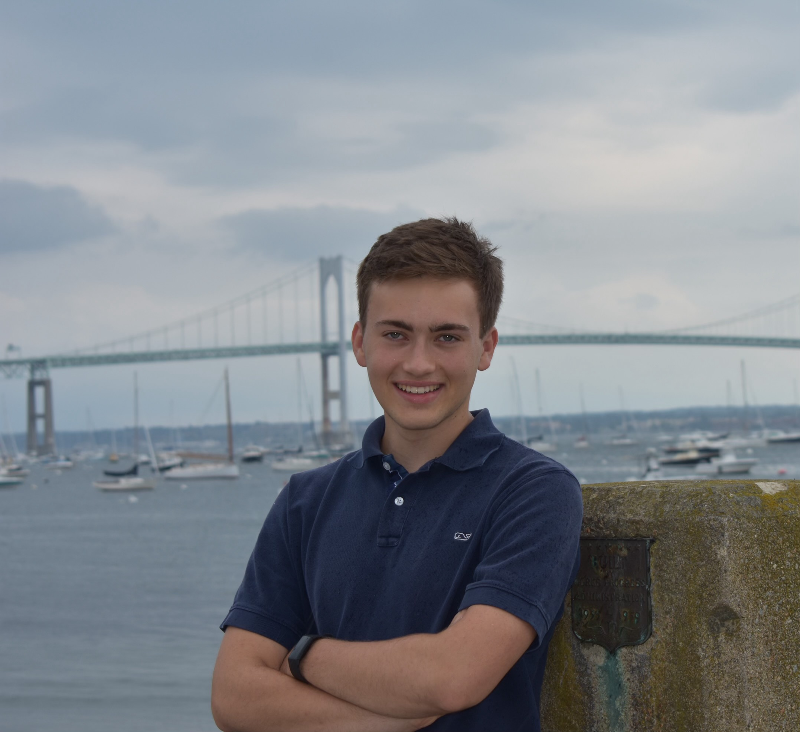

# Hi, I'm Louis Connoni

**Mechanical Engineering · Thermal-Fluid Systems · Hardware · HVAC**

Honors Mechanical Engineering student at Villanova University with a Business minor. Interested in heat transfer, fluid dynamics, phase-change applications, and thermal hardware.

Seeking **Summer 2027 internships** in mechanical engineering, hardware, thermal systems, and HVAC.

[View my résumé](assets/Louis_Connoni_Resume.pdf) · [LinkedIn](https://www.linkedin.com/in/louis-connoni/) · [Email](mailto:Louis.connoni@gmail.com)

 

## Engineering experience

### Consulting Engineering Services
**Mechanical Engineering Intern · May–August 2026**

- Performed HVAC load calculations for buildings up to 40,000 sq. ft.
- Designed Revit HVAC layouts and validated ductwork, piping, and exhaust systems using airflow and static-pressure calculations.
- Developed 19 plumbing schedules and 7 water-heater standards.

### Microsoft Research × Villanova ES2
**Student Researcher · August 2025–June 2026**

- Built a Python and pandas tool to evaluate data-center waste-heat recovery across thermal, water, carbon, economic, and social metrics.
- Created Matplotlib visualizations comparing three recovery methods.

## Selected projects

### [Dynamic Flow Cold Plate](https://github.com/louisconnoni/Variable-Liquid-Flow-Cold-Plate)

Adaptive liquid cooling using CFD, MATLAB, sensors, and closed-loop flow control.

`SolidWorks` `Ansys Fluent` `MATLAB` `Arduino`

### [FREEDOM](https://github.com/louisconnoni/Freedom/blob/main/README.md)

A 3 lb vertical-spinner combat robot designed for impact resistance, reliable operation, and a strict weight limit.

`CAD` `Aluminum` `TPU` `Electronics`

## Skills and leadership

**Engineering:** Heat transfer · Fluid dynamics · HVAC · Psychrometrics · CFD · Thermal modeling · Machine shop · Soldering · Laser cutting

**Tools:** SolidWorks · Ansys Fluent · MATLAB · Revit · AutoCAD · Python · Java · JavaScript · Arduino

**Leadership:** ASME Treasurer · Robotics Team Co-lead · RUIBAL Outreach Chair · Pre-Orientation Leader · Eagle Scout
